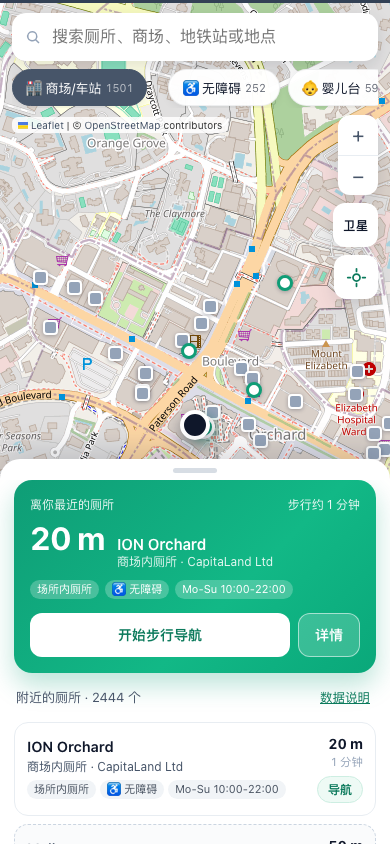
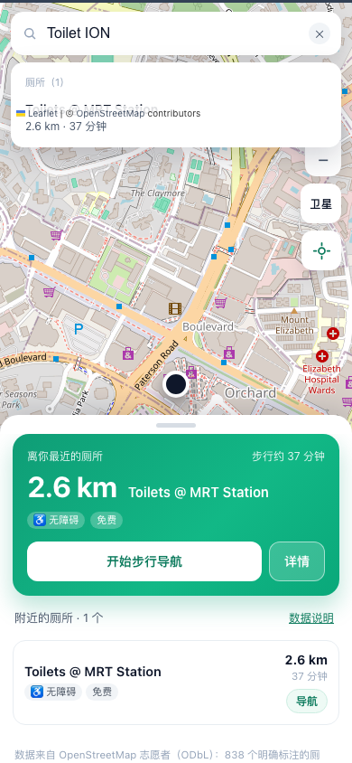
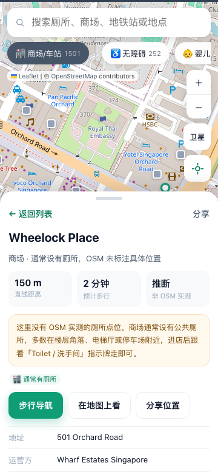
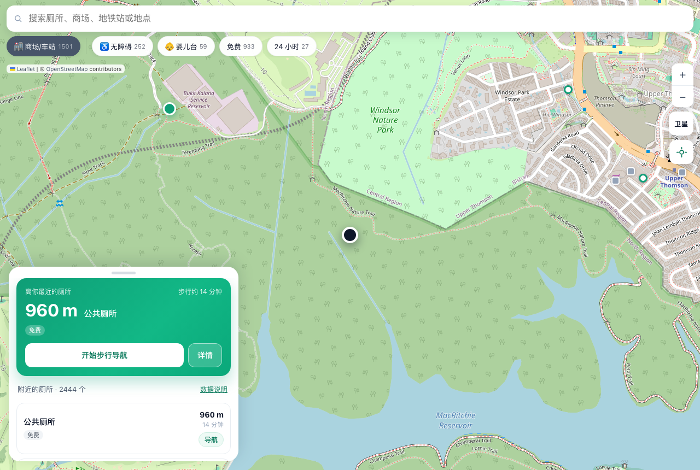
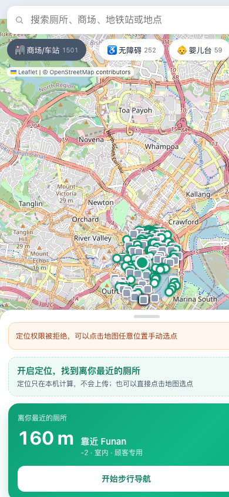

# 找厕所 · 新加坡 (SG Toilet Finder)

移动端优先的 Web 应用：**一键找到离你最近的新加坡厕所**，显示距离和预计步行时间，并直接跳到 Google / Apple 地图步行导航。
不需要任何 API Key 就能完整运行。

| 列表 + 最近推荐 | 搜索（厕所 + 地点） | 备选场所详情 |
| --- | --- | --- |
|  |  |  |

桌面端（≥720px）自动变成左侧浮动卡片：

没有定位权限时也能用：市中心兜底 + 提示点地图手动选点。

---

## 快速开始

```bash
./start.sh            # 开发模式（热更新），http://localhost:5188
./start.sh preview    # 生产模式：build 后跑 dist，http://localhost:5199
./share.sh            # 临时分享：生成一个公开的 https 地址（无需账号，见 DEPLOY.md）
./start.sh install    # 只安装依赖
```

`start.sh` 会自动找可用的 Node（PATH → `~/.local/node22` → homebrew/nvm），缺依赖时自动安装，
并把本机地址、手机可访问的局域网地址都打印出来。

也可以直接用 npm：

```bash
npm install
npm run dev          # 开发服务器
npm run build        # 生产构建，产物在 dist/
npm run preview      # 预览构建结果
npm run fetch:data   # 重新抓取 OSM 数据（可选，见下文）
```

> 浏览器定位（Geolocation）只在 **https** 或 **localhost** 下可用。
> 手机通过局域网 IP（`http://192.168.x.x:5188`）打开时定位会被拒绝，直接**点地图任意位置手动选点**即可；
> 部署到 https 站点后定位就正常了。

---

## 数据模型：两级，且明确区分「实测」和「推断」

Singapore 的 OSM 里明确标注的厕所只有 800 多个，在 Orchard 这种最繁华的地方 900 米内只有 1 个点——
光靠这些数据回答「最近的厕所在哪」是不够的。所以应用用了两级数据，并且在界面上把两者区分清楚：

| 级别 | 数量 | 来源 | 界面表现 |
| --- | --- | --- | --- |
| **实测**：`amenity=toilets` | 838 | OSM 明确标注的厕所点位 | 白色圆点标记，可以筛选无障碍/婴儿台/免费/24 小时 |
| **实测**：`toilets=yes` 的场所 | 105 | OSM 标注「这个场所有厕所」（商场、餐厅、车站等） | 绿色圆点 + 「场所内厕所」标签 |
| **推断**：通常有厕所的场所 | 1501 | 商场、地铁站、小贩中心、图书馆、民众俱乐部、医院、博物馆 | 灰色方块 + 虚线卡片 + 「🏬 通常有厕所」标签，并注明「OSM 未标注具体位置」 |

- 「离你最近的厕所」推荐卡**只使用前两级**，不会拿推断结果糊弄你。
- 推断层可以在筛选条最左边的 **🏬 商场/车站** 开关里一键关掉。
- 一旦打开无障碍/婴儿台等属性筛选，推断层会自动隐藏（这些场所没有这些属性数据，显示出来会误导）。
- 还有 649 个无名厕所通过「最近场所 / 最近地标」自动补上了上下文，显示成「靠近 ION Orchard」而不是干巴巴的「公共厕所」。

---

## 功能一览

| 功能 | 说明 |
| --- | --- |
| 自动定位 | 打开即定位，成功后按距离由近到远排序；失败也不影响使用 |
| 最近厕所推荐 | 渐变卡片给出最近的一个、距离、步行时间，一键跳转导航 |
| 手动选点 | 点击地图任意位置把那里设为起点（定位被拒绝时的兜底方案） |
| 筛选 | ♿ 无障碍 / 👶 婴儿台 / 免费 / 24 小时，按钮上实时显示命中数量 |
| 双源搜索 | 同时搜厕所和场所（本地即时）＋ 搜地点（Nominatim，把起点移到某商场/地铁站） |
| 地图 | 点标记看详情；街道图 / 卫星图切换；缩放与回到我的位置 |
| 详情页 | 坐标、楼层、运营方、开放时间、是否顾客专用、数据来源、OSM 编辑入口 |
| 分享 | 生成带坐标的链接（`?toilet=xxx&fromLat=..&fromLng=..`），对方打开直接看到同一个厕所 |
| PWA | 可添加到主屏幕，Service Worker 缓存应用外壳与点位数据，弱网可用 |
| 桌面适配 | ≥720px 时底部抽屉变成左侧 420px 浮动卡片 |

### 一起用到的免费服务（都不需要 Key）

- 地图瓦片：OpenStreetMap 官方瓦片 / Esri World Imagery（卫星）
- 厕所数据：OpenStreetMap，经 Overpass API 抓取（ODbL 许可，界面已署名）
- 地点搜索：Nominatim（已做 500ms 防抖 + 内存缓存，请勿高频调用）

---

## 关于 Google Maps API

按需求「不配 Key 也能跑」来设计的，Google 相关能力分三档：

**1. 导航跳转（零配置，已内置）**
所有「导航」按钮都走 Google Maps 通用链接，不需要 Key：
`https://www.google.com/maps/dir/?api=1&destination=<lat>,<lng>&travelmode=walking`
iOS 上同时提供 Apple 地图 / Citymapper 入口。

**2. 可选：Google Places 补充数据（需要 Key）**
复制 `.env.example` 为 `.env`：

```env
VITE_GOOGLE_MAPS_API_KEY=AIza...
```

重新构建后，定位成功时会调用 Places API (New) 的 `searchNearby`（类型 `public_bathroom`），
把 OSM 未收录的厕所补进列表，并与已有 OSM 点位做 60 米去重。
需要启用 **Places API (New)**，建议给 Key 加 HTTP referrer 限制和配额上限（用的是可公开的前端 Key）。

**3. 可选：把底图换成 Google 地图**
底图配置集中在 `src/lib/mapTiles.ts`。要换成 Google 需要自己申请 Maps JavaScript API
并遵守其服务条款；把该文件里的瓦片源换掉即可，其他代码不用动。

---

## 重新抓取数据

内置数据是构建时抓取的快照（`public/data/*.json`）：

```bash
npm run fetch:data              # 优先使用 scripts/.cache/ 里的缓存，只补缺的部分
node scripts/fetch-osm-toilets.mjs --refresh   # 忽略缓存，全部重新抓
```

- Overpass 全岛查询一次要几十秒，还经常 `429`（限流）或 `504`（超时），
  所以脚本会把每条查询的原始响应缓存到 `scripts/.cache/`，失败重试时不用从头再来。
- 应用内也能刷新：底部面板 → **数据说明** → 「从 OpenStreetMap 在线更新点位」（只更新实测厕所图层）。

## 项目结构

```
sg-toilet-finder/
├── index.html                      # 移动端 meta、PWA 入口
├── public/
│   ├── data/toilets.json           # 943 个厕所（实测 838 + 场所内 105）
│   ├── data/places.json            # 1501 个「通常有厕所」的场所（推断层）
│   ├── manifest.webmanifest / sw.js / icon*
├── scripts/
│   ├── fetch-osm-toilets.mjs       # Overpass 抓取 + 分类 + 地标匹配 + 缓存
│   └── .cache/                     # Overpass 原始响应缓存（已 gitignore）
├── docs/                           # 截图
└── src/
    ├── App.tsx                     # 状态编排：定位、搜索、筛选、选中、分享
    ├── index.css                   # 全部样式（移动端优先 + 安全区适配）
    ├── components/
    │   ├── MapView.tsx             # Leaflet 地图、标记分级、视野内渲染、街道/卫星切换
    │   ├── BottomSheet.tsx         # 可拖拽底部抽屉
    │   ├── NearestCard.tsx         # 「离你最近」推荐卡
    │   ├── ToiletListItem.tsx      # 列表项（实测/推断两种样式）
    │   ├── ToiletDetail.tsx        # 详情页（含推断层的说明文案）
    │   ├── SearchBar.tsx           # 双源搜索（厕所 + 地点）
    │   ├── FilterChips.tsx         # 数据层级开关 + 属性筛选
    │   └── InfoPanel.tsx           # 数据来源、在线更新、Google 说明
    ├── hooks/
    │   ├── useGeolocation.ts       # 定位状态机 + 手动选点兜底
    │   └── useDebouncedValue.ts
    └── lib/
        ├── geo.ts                  # 球面距离、步行时间、格式化
        ├── toilets.ts              # 排序、标题/副标题、徽章、筛选、搜索、推断层转换
        ├── navigate.ts             # Google/Apple/Citymapper 深链 + 分享链接
        ├── geocode.ts              # Nominatim 地点搜索（限新加坡）
        ├── overpass.ts             # 应用内在线刷新（Overpass）
        ├── googlePlaces.ts         # 可选的 Places API (New) 集成
        └── mapTiles.ts             # 底图配置（想换地图只改这里）
```

---

## 精度与免责说明

- **距离**是球面直线距离，实际步行距离会更长；**步行时间**按 1.15 m/s（约 4.1 km/h，含等红灯）估算。
- **开放时间**来自 OSM 的 `opening_hours` 标签，只做「大概现在开不开」的判断，不做严格解析。
- **推断层的场所没有具体厕所位置**，只表示「这类场所通常有厕所」，到现场后跟着指示牌走。
- 数据是志愿者众包的，可能过期或有误。详情页提供「在 OSM 查看/编辑」入口，欢迎顺手修正。

## 常见问题

- **`npm run dev` 报 `Cannot find module @rollup/rollup-darwin-*` 或 `ERR_DLOPEN_FAILED`**
  少见情况：你用的 Node 开了 macOS 硬编码运行时（hardened runtime）却没给
  `com.apple.security.cs.disable-library-validation` 权限，导致加载不了 rollup 的原生模块。
  换用 [nodejs.org](https://nodejs.org) 官方安装包或 nvm/homebrew 安装的 Node 即可（官方包带该权限）。
- **手机上打不开定位**：必须 https（或用 localhost）。局域网 http 调试时点地图手动选点即可。
- **Overpass 429/504**：说明被限流了，等一两分钟再跑 `npm run fetch:data`，有缓存不会白跑。

## 部署

纯静态、无服务端、不需要任何环境变量（除非启用可选的 Google Places）：

```bash
npm run build   # 产物 dist/，扔到任何静态托管即可
```

最省事的两种：

```bash
npx vercel --prod                    # Vercel（已带 vercel.json）
npx netlify-cli deploy --prod --dir=dist   # Netlify（已带 netlify.toml）
```

GitHub Pages 也已经准备好 workflow（`.github/workflows/deploy-pages.yml`），
仓库 Settings → Pages → Source 选 GitHub Actions 即可。
**完整部署说明、国内访问方案和上线检查清单见 [DEPLOY.md](DEPLOY.md)。**

部署后必须用 **https**，否则浏览器不给定位权限。

## 已知取舍

- 地图没做点位聚合，改用「只渲染视野内的点位」保证手机端流畅（低缩放级别下只显示最近的 60 个）。
- 没画步行路线（需要 Valhalla/OSRM 等路由服务），改为直接跳系统/Google 地图导航，更可靠。
- 推断层为了体积做了取舍：只收录 7 类场所，且只保留有名字的点。
